# Projekt-FEM

**Festigkeitsberechnung (FEM) für Konstrukteure, Maker und den 3D-Druck – vom CAD-Teil zum Ergebnis in Minuten.**

STEP-Datei öffnen oder direkt aus dem CAD schicken, Lager und Lasten auf Flächen klicken, rechnen: Spannungen,
Verformung, Sicherheit und Festigkeitsnachweis – auch für 3D-Druckteile mit Schichtaufbau, Wänden und Infill und für
geschweißte Bleche. Ändert man das Teil im CAD (Onshape, SolidWorks, Fusion, SolidCraft …), rechnet Projekt-FEM die
neue Version mit denselben Lagern und Lasten nach. Eigener Rechenkern in Rust, Desktop-App für Linux und macOS,
Bedienung auch im Browser über das Heimnetz.

> Arbeitsname, der endgültige Name kommt noch. Privates Projekt, Stand November 2026.

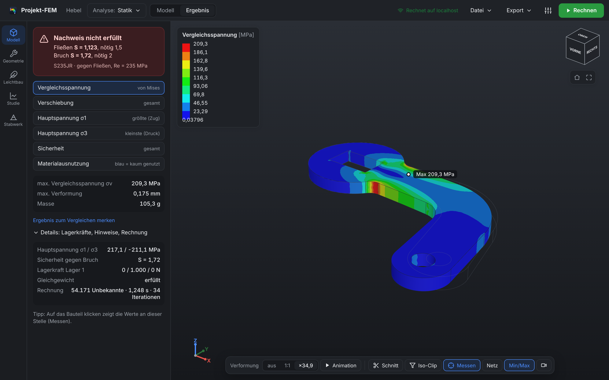

## Funktionen

| Bereich | Was geht |
|---|---|
| **Geometrie & Netz** | STEP-Import, automatische Vernetzung (Gmsh, quadratische Tetraeder TET10), feiner an Bohrungen/Radien und in Lastbereichen, Netzgröße per Schieberegler |
| **Lager** | fest, reibungsfrei/Symmetrie (auch schräge Flächen), Richtungen einzeln, zylindrisch (Bolzen/Gelenk) |
| **Bedienung** | Startseite (Datei, Onshape-Bibliothek, Projekt, zuletzt geöffnet), **Studienbaum** wie im CAD (Teil, Werkstoff, Netz, Lager, Lasten, Verbindungen), grüner **Rechnen**-Knopf mit Liste der offenen Punkte, Ansichtswürfel, Koordinatensystem, Maus-/Trackpad-Steuerung wie SolidWorks, Onshape, Fusion oder Mac-Trackpad |
| **Lasten** | Kraft (Betrag + Richtung: senkrecht auf die Fläche, X/Y/Z, im Bild ziehen, von einer Fläche übernehmen), Druck, Moment, Bolzenlast, Strömung/Wind – jeweils auf ganzer Fläche oder nur in einem gezeichneten **Wirkbereich** (Kreis, Rechteck, Wellenabschnitt) |
| **Ergebnisse** | Urteil oben (Nachweis erfüllt / nicht erfüllt), Vergleichsspannung, Verschiebung, Hauptspannungen, Sicherheit, Materialausnutzung; Leiste im Bild: Verformung, **Animation** (Last 0 → 100 %), **Schnitt**, **Iso-Clip** (nur Bereiche über/unter einem Wert), Messen, Min/Max, **Video**; Lagerkräfte mit Gleichgewichtskontrolle, Warnungen (Singularität, Fließen, große Verformung) |
| **Nachweis & Bericht** | Werkstoffdatenbank (Stahl, Alu, Kunststoffe, Druckwerkstoffe, eigene), Masse, Festigkeitsnachweis mit erforderlichen Sicherheiten, PDF-Bericht, MathPad-Rechenblatt, ParaView-Export |
| **3D-Druck** | Schichtaufbau mit Werten in und quer zu den Schichten, Aufbaurichtung frei optimieren (≈ 400 Richtungen) inkl. Überhänge, Wände + Infill (Gyroid, Gitter, Waben …), Kalibrierung mit eigenem Zugstab |
| **Schweißnähte** | Spalte an Blechecken automatisch finden, Stumpf-/Kehlnaht, Nahtkraft und Nachweis nach EN 1993-1-8 (vereinfacht) |
| **Baugruppen** | mehrere Körper aus einer STEP-Datei bzw. Onshape-Baugruppe mit Namen, Werkstoff je Körper, ein-/ausblenden, Berührflächen verbunden, Spalte als Naht oder flächige Verbindung, **Schrauben** automatisch erkennen (Normteile, Bohrungen) oder von Hand an Bohrungen anlegen, Festigkeitsklasse, **Vorspannung nach VDI 2230** mit Anziehstreuung und Setzen, **Kontakt mit Reibung** (klaffen, rutschen) in Schraubenfugen und an beliebigen Berührflächen, Nachweis mit Flächenpressung, Einschraubtiefe und Dauerfestigkeit, Ergebnis und Kräfte je Körper |
| **Studien** | Parameterstudie (Netz, Füllgrad, Maße, **Onshape-Variablen**, **SolidCraft-Parameter**), Vergleich mit voriger Version |
| **Weitere Analysen** | Eigenfrequenzen, Knicken (Lanczos), Leichtbau-Vorschlag (Topologieoptimierung, STL-Export), Stabwerk (Balken, Rahmen, Fachwerke mit IPE-Profilen) |
| **Konstruktion (kleines CAD)** | Teile direkt zeichnen oder importierte Teile ändern: Skizze mit Maßen und Bedingungen, Extrudieren, Drehen, Bohrung, Verrunden, Fase, Muster, Spiegeln, Feature-Verlauf |
| **CAD-Anbindung** | Onshape (**Bibliothek** mit Vorschaubildern, Lesezeichen, API), SolidWorks (Makro), Fusion (Add-in), SolidCraft (live), NX, Solid Edge, „Senden an“ für jedes CAD – Ergebnis zurück ins CAD |
| **Heimnetz & Server** | starker PC rechnet, Laptop/Arbeits-PC bedient im Browser – ohne Installation; oder als Docker-Container auf einem Server (wie MathPad) |
| **Rechenkern** | Rust, direkter Löser (Cholesky) und iterativer Löser (PCG + algebraisches Mehrgitter) bis über 2 Mio. Unbekannte, 76 Lehrbuchprüfungen |

## Bilder

| | |
|---|---|
| 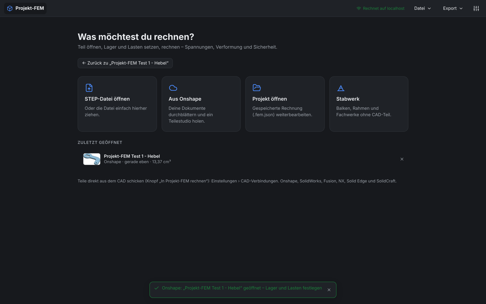 | 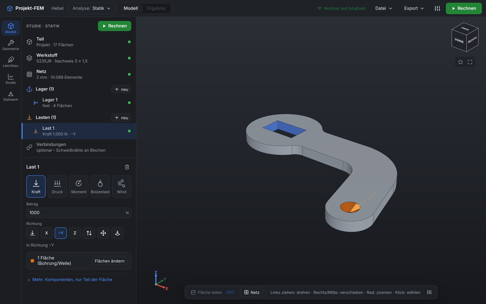 |
| **Startseite:** Datei öffnen oder hierher ziehen, aus Onshape holen, zuletzt geöffnet mit Vorschaubild | **Modell:** Studienbaum wie im CAD, darunter die Eigenschaften des gewählten Eintrags – hier die Kraft mit Betrag und Richtung als Symbole |
| 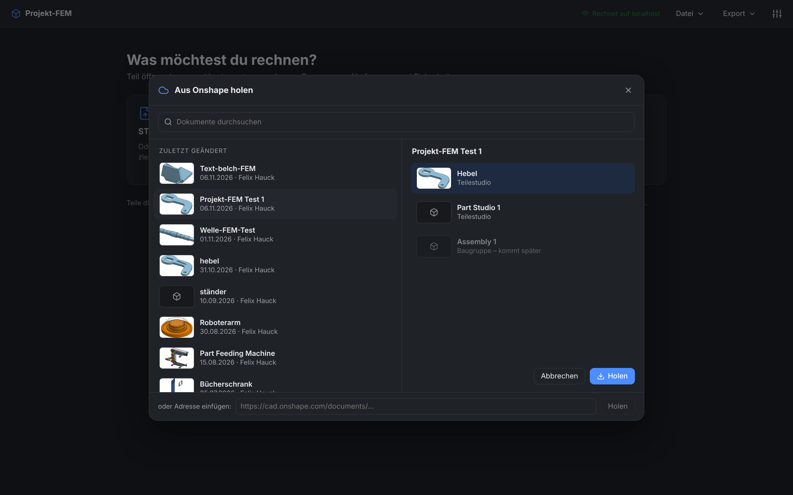 | 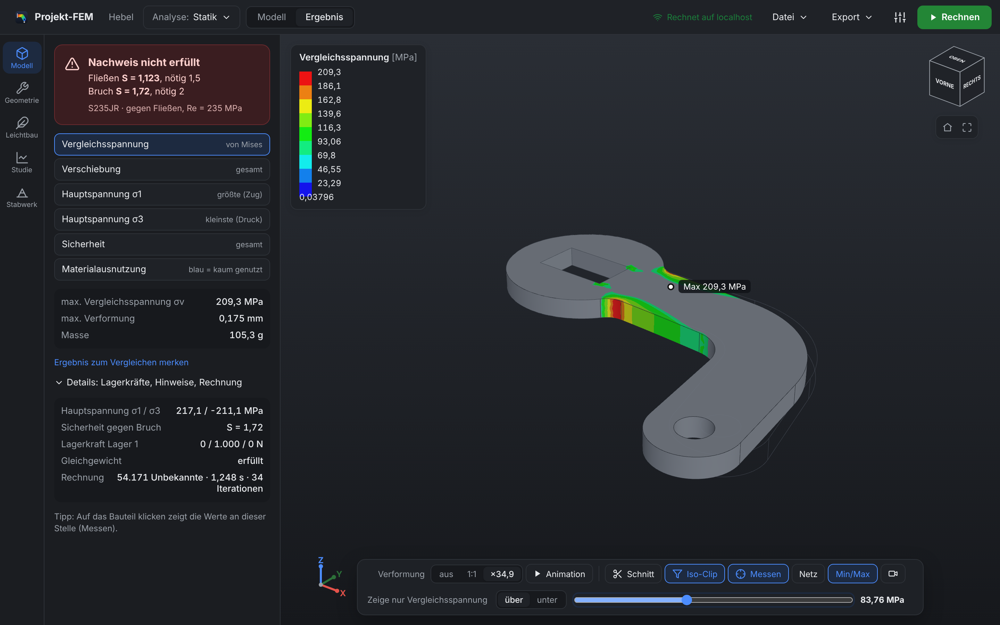 |
| **Onshape-Bibliothek:** eigene Dokumente durchsuchen, Teilestudio wählen, holen – ohne Adresse kopieren | **Iso-Clip:** nur die Bereiche über 84 MPa farbig, der Rest grau – wie in SolidWorks Simulation |
| 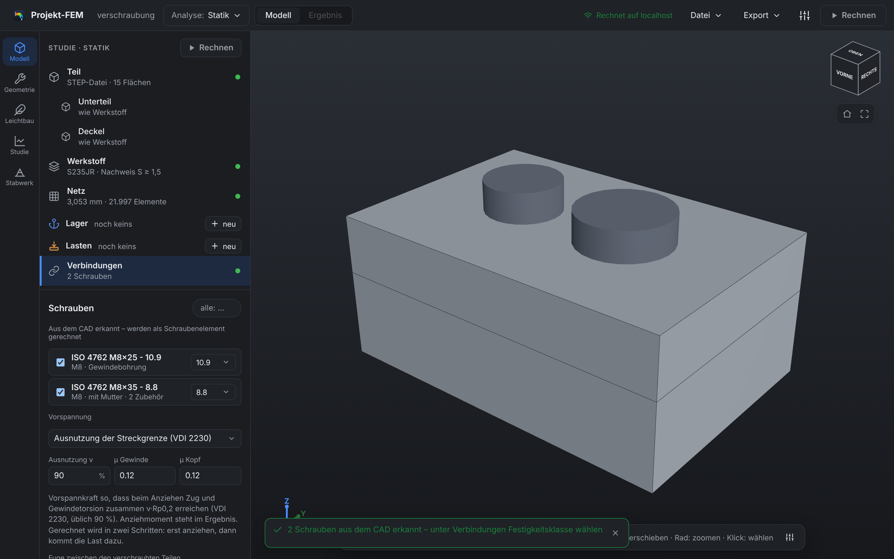 | 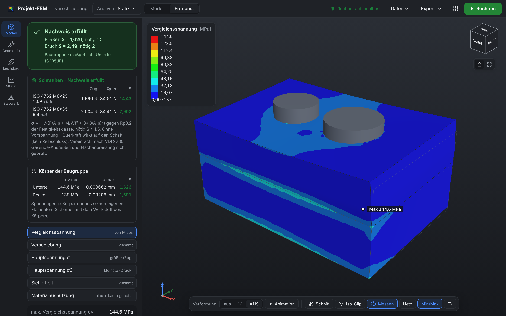 |
| **Schrauben erkannt:** zwei Normteile aus dem CAD (10.9 mit Gewindebohrung, 8.8 mit Scheibe und Mutter), Klasse je Schraube, Vorspannung nach VDI 2230 | **Vorgespannt und Kontakt:** F_V von–bis (Anziehstreuung, Setzen), Schraubenkraft im Betrieb, Nachweis mit Gewindetorsion, Flächenpressung und Einschraubtiefe; Fuge mit Restklemmkraft und Reibschluss |
| 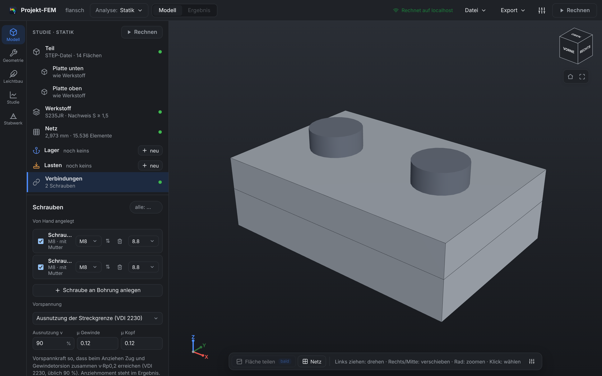 | |
| **Schraube von Hand:** Bohrung anklicken – fluchtende Bohrungen der anderen Teile kommen dazu, Größe wählbar, Kopf umdrehbar | |
| 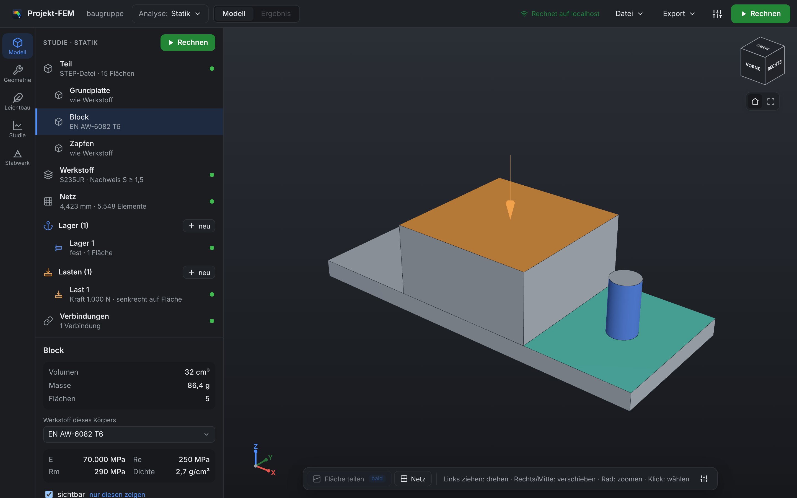 | 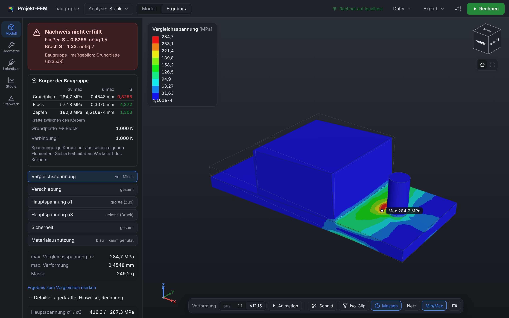 |
| **Baugruppe:** Körper mit Namen aus dem CAD, Block aus Alu, loser Zapfen flächig verbunden (türkis) | **Ergebnis je Körper:** Spannung, Verformung, Sicherheit mit eigenem Werkstoff, Kräfte zwischen den Körpern |
| 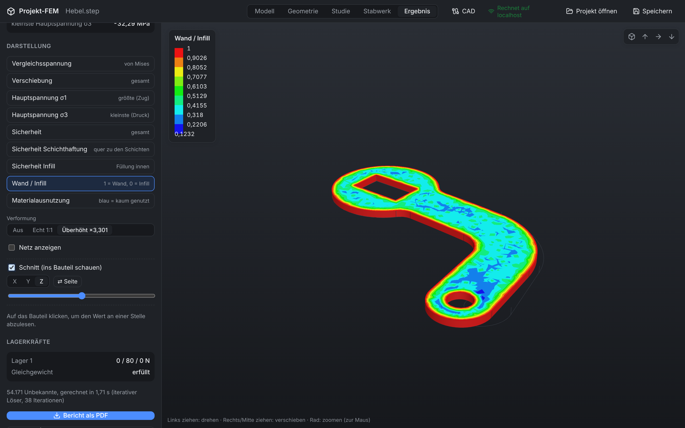 | 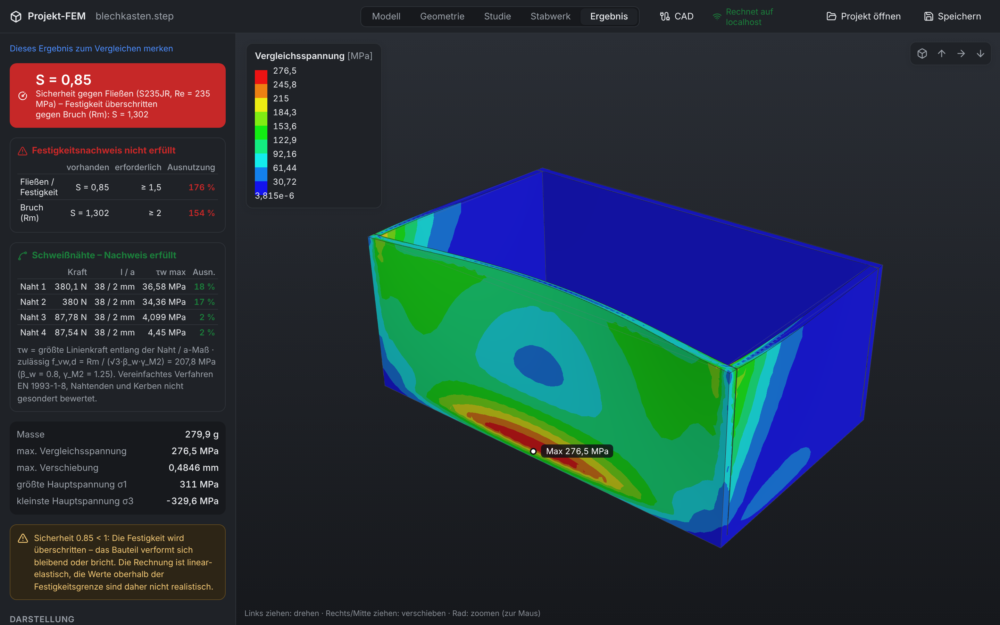 |
| **3D-Druck:** Wand (rot) und Gyroid-Infill im Schnitt, Sicherheit getrennt für Wand, Infill und Schichthaftung | **Schweißnähte:** Blechkasten mit vier gefundenen Eckspalten, Nahtkräfte und Nachweis |
| 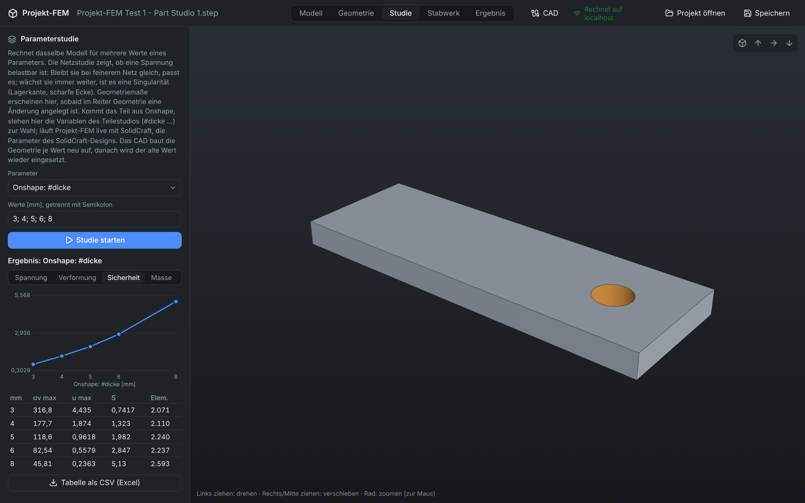 | 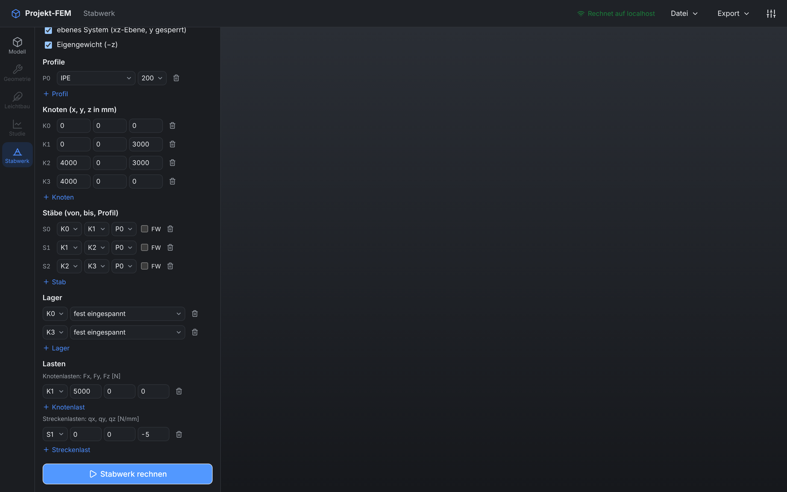 |
| **Onshape-Variable:** `#dicke` 3–8 mm – Projekt-FEM ändert die Variable in Onshape und rechnet jede Variante | **Stabwerk:** eingespannter Rahmen aus IPE 200, Ausnutzung je Stab |
| 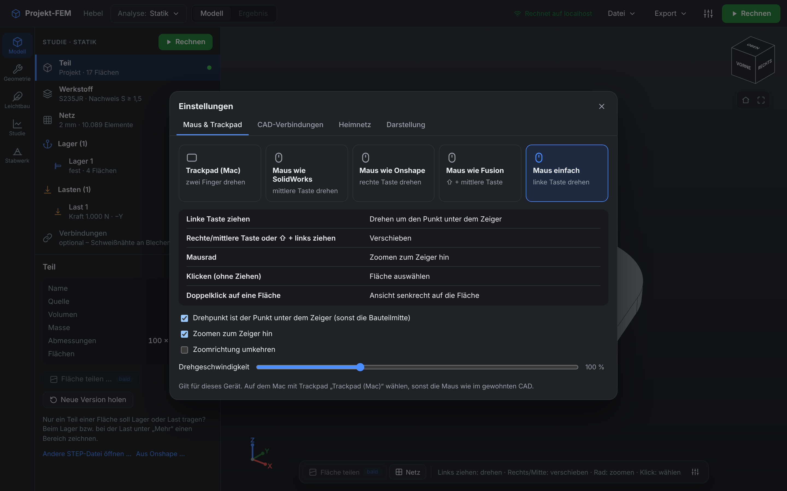 | 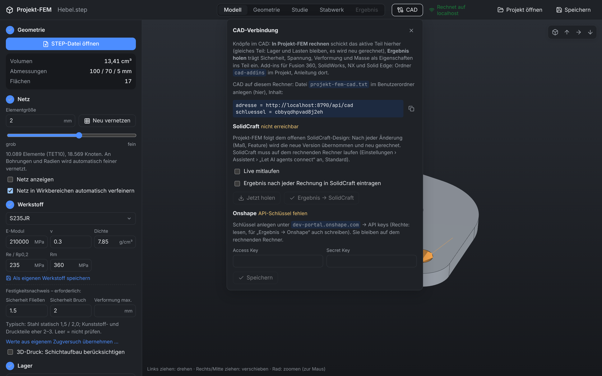 |
| **Maus & Trackpad:** Steuerung wie im gewohnten CAD – drehen um den Punkt unter dem Zeiger, zoomen zum Zeiger | **CAD-Verbindungen:** Onshape-Schlüssel und Lesezeichen, SolidCraft live, Einstellungen für die Add-ins |

## Schnellstart

1. **Voraussetzungen:** Rust, Node.js und Gmsh (`uv tool install gmsh` oder `brew install gmsh`); unter Linux zusätzlich
   `webkit2gtk-4.1`. Details unter [Bauen](#bauen-und-benutzen).
2. **Bauen:** `cd app && npm install && npx tauri build --no-bundle` → `target/release/projekt-fem-app`
3. **Rechnen:** App starten → Startseite **STEP-Datei öffnen** (z. B. `Daten/Hebel.step` oder `examples/geometrie/`) →
   im Studienbaum **Werkstoff** wählen → bei **Lager** auf „neu“ und Flächen anklicken → bei **Lasten** auf „neu“, Fläche
   anklicken, Betrag eintragen → **Rechnen** (grün, sobald alles festgelegt ist; sonst nennt der Knopf die offenen Punkte).
4. **Aus dem CAD:** Startseite **Aus Onshape** (eigene Dokumente durchblättern), Einstellungen (Regler-Symbol oben rechts)
   › **CAD-Verbindungen** für Onshape-Schlüssel, Lesezeichen und SolidCraft live; Add-ins für SolidWorks und Fusion in
   [`cad-addins`](cad-addins/README.md).

Ein ausführlicher Prüfablauf aller Funktionen steht in [`TESTPROTOKOLL.md`](TESTPROTOKOLL.md), geplante Schritte in
[`NAECHSTE_SCHRITTE.md`](NAECHSTE_SCHRITTE.md).

## CAD-Anbindung

Knöpfe direkt im CAD: **„In Projekt-FEM rechnen“** schickt das aktive Teil als STEP an Projekt-FEM,
**„Ergebnis holen“** trägt Sicherheit, Vergleichsspannung, Verformung, Masse und Nachweis als Eigenschaften ins Teil ein.
Kommt dasselbe Teil (gleicher Name) in einer neuen Version, überträgt Projekt-FEM Lager, Lasten und Nähte auf die neue
Geometrie, rechnet automatisch neu und zeigt den Vergleich zur vorigen Version.

| CAD | Weg | Ergebnis zurück | Getestet |
|---|---|---|---|
| **Onshape** | Bibliothek in Projekt-FEM (Datei › Aus Onshape) oder Lesezeichen „→ Projekt-FEM“ im Teilestudio (API-Schlüssel in Projekt-FEM) | Teilebeschreibung `[FEM …]` (Export › Ergebnis → Onshape) | ✅ mit echtem Onshape, inkl. Bibliothek und Studie über Variablen |
| **SolidCraft** | live über den Steuerkanal: folgt jeder Änderung | Parameter `FEM_…` + Design-Eigenschaft | gegen Nachbau des Protokolls |
| **SolidWorks** | VBA-Makro, zwei Makro-Knöpfe | benutzerdefinierte Eigenschaften (`$PRP:"FEM_Sicherheit"`) | ungetestet |
| **Autodesk Fusion** | Add-in, Gruppe „Projekt-FEM“ | Benutzerparameter + Attribute | Ablauf mit Platzhaltern |
| **Siemens NX** | Python-Journale als Benutzerbefehl | Teile-Attribute | Ablauf mit Platzhaltern |
| **Solid Edge** | VBScript | benutzerdefinierte Eigenschaften | ungetestet |
| **jedes andere** | STEP speichern → „Senden an → An Projekt-FEM“ (Windows) / Schnellaktion (Mac) | – | Mac/Linux-Skript getestet |

Anleitung je Programm: [`cad-addins/README.md`](cad-addins/README.md). CAD auf einem anderen Rechner als Projekt-FEM:
Heimnetz-Freigabe einschalten (Einstellungen › Heimnetz), Adresse und Schlüssel stehen unter Einstellungen › CAD-Verbindungen.

## Funktionen im Detail

### Bedienung

Aufbau wie in einem CAD-Simulationsmodul:

- **Kopfleiste:** Logo → Startseite, Teilname, **Analyse** (Statik, Eigenfrequenzen, Knicken), **Modell | Ergebnis**,
  Menüs **Datei** und **Export**, Einstellungen, **Rechnen**. Der Knopf ist grün, sobald alles festgelegt ist; sonst grau
  und zeigt beim Anklicken die offenen Punkte – ein Klick springt zum passenden Eintrag.
- **Werkzeugleiste links:** Modell, Konstruktion, Leichtbau, Parameterstudie, Stabwerk.
- **Studienbaum:** Teil, Werkstoff, Netz, Lager, Lasten, Verbindungen – grüner Punkt = festgelegt, Kreis = offen.
  Darunter die Eigenschaften des gewählten Eintrags. Lager- und Lastarten als Symbole; eine Kraft hat Betrag und
  Richtung (Standard: **senkrecht auf die gewählte Fläche**, sonst X/Y/Z, umkehren, Pfeil im Bild ziehen oder Richtung
  von einer Fläche übernehmen). Seltenes (Komponenten, Teilbereich der Fläche, eigene Werkstoffwerte) liegt unter „Mehr“.
  Eine farbige Fläche im Bild anklicken wählt das zugehörige Lager bzw. die Last im Baum.
- **3D-Ansicht:** Ansichtswürfel (Fläche anklicken = Blick senkrecht darauf), Startansicht, Alles zeigen,
  Koordinatensystem (Achse anklicken = Blick auf die Ebene), Doppelklick auf eine Fläche = Blick senkrecht darauf.
  Maus und Trackpad unter Einstellungen › **Maus & Trackpad**: wie SolidWorks (Mitte drehen), Onshape (rechts drehen),
  Fusion (⇧ + Mitte), Mac-Trackpad (zwei Finger drehen, spreizen zoomen, Klick wählt nur) oder einfach (links drehen);
  gedreht wird um den Punkt unter dem Zeiger, gezoomt zum Zeiger hin.
- **Ergebnis:** oben das Urteil (grün/rot) mit Sicherheiten, darunter Größe wählen (σv, u, S, mehr), Kennwerte, Details
  zum Aufklappen. Im Bild die Darstellungsleiste: Verformung aus / 1:1 / überhöht, **Animation**, **Schnitt**,
  **Iso-Clip** (nur Bereiche über bzw. unter einem Wert farbig), **Messen** (Klick zeigt σv, u und S an der Stelle),
  Netz, Min/Max, Video. Farbverlauf in Stufen oder fließend, helles oder dunkles Erscheinungsbild: Einstellungen › Darstellung.

**Animation:** Die Last steigt von 0 auf 100 % und wieder zurück, Verformung und Farben wachsen
mit (½×, 1×, 2× Geschwindigkeit). **Video** speichert zwei Durchläufe als WebM bzw. MP4 mit Bauteilname, Werkstoff,
Kennwerten, Überhöhung und Farbskala – zum Zeigen und Weitergeben. (In der Linux-Desktop-App kann die Aufnahme je nach
WebKit-Version fehlen; dann über die Heimnetz-Ansicht in Chrome/Firefox aufnehmen.)
Projekte speichern/laden (`.fem.json`, im Browser mit eingebetteter STEP-Datei), Fortschrittsanzeige bei großen Netzen.

**Wirkbereich** (bei Lager bzw. Last unter „Mehr“): Lasten und Lager können statt auf der ganzen Fläche nur auf einem
Teil wirken. Den Bereich zieht man mit der Maus direkt auf der Fläche auf (als Nächstes kommt „Fläche teilen“ mit einer
Skizze, die an der Fläche ausgerichtet ist): Kreis, Rechteck oder Abschnitt einer Welle/Bohrung (axial von–bis, optional
nur ein Winkelbereich). Danach lassen sich die Maße als Zahlen anpassen; das Netz wird dort automatisch feiner.

### 3D-Druck: Schichtaufbau, Aufbaurichtung, Wände und Infill

Werkstoff mit „3D-Druck: Schichtaufbau berücksichtigen“: eigene Werte **in der Schicht (XY)** und **quer zu den
Schichten (Z)** für E, Re/Rp0,2 und Rm (transversal isotrop). Vorlagen für FDM (PLA, PETG, ABS, ASA, PC, PA12-CF),
SLS/SLA (PA12, PA11, Resin) und Metall (AlSi10Mg, 316L, Ti-6Al-4V) – Richtwerte für 100 % Füllung, eigene Werte
eintragen, wenn bekannt. Aufbaurichtung X/Y/Z oder „Fläche aufs Druckbett legen“; Schichtlinien und Druckbett werden
angezeigt.

Auslastung je Knoten: max(σv / R_xy, Schichthaftung), Schichthaftung = √((σ_z⁺ / R_z)² + (τ_z / S_z)²) in
Schichtkoordinaten (Druck quer zu den Schichten zählt nicht, S_z = R_z). R = Re/Rp, ohne Streckgrenze Rm.
Ergebnis: Sicherheit gesamt und „Sicherheit Schichthaftung“, maßgebliche Versagensart, Sicherheit gegen Bruch (Rm).
**„Aufbaurichtung vergleichen“** rechnet X, Y und Z; die **Richtungssuche** bewertet rund 400 Richtungen nach Sicherheit
und Stützmaterial (Überhänge ab 45° werden angezeigt) und übernimmt die beste per Klick. Eigene Zugstab-Messwerte
lassen sich als Kalibrierung übernehmen.

**Wände und Infill** („Wände und Infill berücksichtigen“): Füllmuster (Gitter, Linien, Dreiecke, Waben, Gyroid,
Kubisch, Kreuz), Füllgrad, Anzahl Wände × Linienbreite, Deck-/Bodenschichten × Schichthöhe. Elemente in Wand- bzw.
Deckschichtdicke von der Oberfläche bekommen den vollen Werkstoff, der Kern einen Ersatzwerkstoff (Näherung
f(ρ) = k·ρⁿ + (1−k)·ρ⁸ je Muster für E und R, in der Schicht und quer). Teilweise betroffene Elemente werden nach
Volumenanteil gemischt; Auslastung getrennt für Wand und Infill. Das Netz wird an der Oberfläche auf Wandstärke
verfeinert. Ergebnisansichten „Sicherheit Infill“ und „Wand / Infill“, dazu die **Schnittansicht** (X/Y/Z, Position).

Grenzen: Ersatzwerte des Infills sind Näherungen (mit eigenem Zugstab kalibrieren); Stützstrukturen werden nicht
abgebildet; linear-elastisch, kein Kriechen.

### Schweißnähte (Bleche)

Gekantete Bleche mit geschlossenen Ecken haben im CAD einen kleinen Spalt (z. B. 0,1–1 mm) – ohne Naht sind die
Bleche dort lose. Im Reiter Modell unter **„Schweißnähte“**:

- **„Spalte suchen“** findet einander gegenüberliegende ebene Flächen mit Spalt bis zur angegebenen Weite
  (z. B. die vier Ecken eines Blechkastens) → einzeln oder alle als Naht übernehmen.
- Oder von Hand: **Naht hinzufügen** → Fläche A (meist die schmale Stirnfläche) und Fläche B anklicken.
- **Stumpfnaht durchgeschweißt** (a = Blechdicke) oder **Kehlnaht** mit a-Maß; „Spalt bis“ leer = automatisch.

Rechnerisch wird jeder Knoten von Fläche A mit dem nächsten Punkt von Fläche B gekoppelt (sehr steife Verbindung über
den Spalt). Ergebnis je Naht: übertragene Kraft, Linienkraft entlang der Naht, Nahtspannung τw = größte Linienkraft / a
und der Nachweis nach dem vereinfachten Verfahren EN 1993-1-8 (4.5.3.3): τw ≤ f_vw,d = Rm / (√3·β_w·γ_M2), β_w nach
Stahlsorte (S235: 0,8, S355: 0,9 …), γ_M2 = 1,25. Auch Teile aus mehreren getrennten Körpern lassen sich so verbinden.
Gilt für Statik, Eigenfrequenzen, Knicken und Leichtbau. Beispiel: `examples/geometrie/blechkasten.step`.

### Auswerten und Weitergeben

- **Schnittansicht** (Ergebnis): Ebene X/Y/Z verschieben, Schnittfläche zeigt die Werte im Inneren.
- **Festigkeitsnachweis**: erforderliche Sicherheit gegen Fließen und Bruch, zulässige Verformung (Werkstoff-Bereich);
  im Ergebnis Ausnutzung je Nachweis und „erfüllt/nicht erfüllt“.
- **PDF-Bericht**: Bauteil, Netz, Werkstoff (inkl. 3D-Druck), Lager, Lasten, Ergebnisse, Nachweis, Hinweise, Bilder mit
  Farbskala, Annahmen und Grenzen.
- **MathPad**: Export als `.mathpad`-Rechenblatt (Werkstoffwerte, Maximalwerte, Lagerkräfte, Masse und Nachweis als
  Formeln, z. B. `S_F = R_e / σ_v`).
- **Parameterstudie** (Reiter „Studie“): Netzgröße (Konvergenz), Füllgrad, Maße aus der Konstruktion (Skizzenmaße, Tiefen, Radien …),
  **Onshape-Variablen** (`#dicke` …) oder **SolidCraft-Parameter** über mehrere Werte – Tabelle, Diagramm, CSV-Export.
- **Werkstoffe**: Vorlagen mit Dichte (Masse im Ergebnis), eigene Werkstoffe speichern
  (`~/.config/projekt-fem/werkstoffe.json`), Werte aus eigenem Zugversuch übernehmen.

### Konstruktion (kleines CAD)

Reiter **„Konstruktion“** – oder auf der Startseite **„Neues Teil konstruieren“**. Abläufe wie in Onshape; gerechnet
wird im Browser (OpenCASCADE als WebAssembly), der Server speichert nur die fertige STEP-Datei. Taste **?** zeigt alle
Tastenkürzel.

1. **Skizze** (S): Hauptebene oder ebene Fläche anklicken – oder erst eine Fläche anklicken, dann S. Ebene mit
   „Abstand zur Ebene“ verschieben und um ihre Achsen **neigen**. Werkzeuge: Linie (L), Rechteck (R), Rechteck aus der
   Mitte (M), Kreis (C), Bogen (A), Tangentenbogen (G), Langloch (O), Vieleck (V, +/− Ecken), Ecke verrunden (F),
   Spiegeln (I), Punkt (P), Maß (D), Verlängern (E), Trimmen (T), Kante übernehmen (U); Q = Hilfslinie,
   Strg+C/Strg+V kopiert Elemente (auch in eine andere Skizze), „Muster …“ an der Auswahl legt Reihen oder Lochkreise an. Wie in Draftpad stehen Länge und Winkel am Zeiger und
   rasten auf glatte Werte (⇧ = frei); einfach die Zahl tippen: `50`, `50@30`, `60x40`, Ø – daraus werden Maße.
   Elemente anklicken (oder Rahmen aufziehen: → ganz drin, ← berührt) zeigt die passenden **Bedingungen** gleich
   daneben (waagrecht, senkrecht, parallel, rechtwinklig, gleich, tangential, deckungsgleich, Punkt auf, Mittelpunkt,
   symmetrisch, fixieren, Hilfslinie, Versatz, Spiegeln). Status oben: „✓ bestimmt“ bzw. „n frei“.
2. **Extrudieren** (E): dazu / weg / neuer Körper; Tiefe, **bis Fläche** oder durch alles; Tiefe auch mit dem Griff im
   Bild ziehen. „Weg“ auf einer Bauteilfläche schneidet automatisch ins Material. Flächen der Skizze im Bild an- und
   abwählen; nach „Skizze fertig“ bietet eine Leiste „weiter mit Extrudieren / Drehen“ an. **Drehen** (R) um eine Linie.
3. **Bohrung** (H): Fläche anklicken, Punkte setzen, fertig – oder Punkte einer Skizze. Durchgangsloch nach ISO 273
   (fein/mittel/grob) oder Gewinde-Kernloch M2–M24, Tiefe mit Spitze oder durchgehend, Senkungen; bohrt immer ins
   Material.
4. **Verrunden / Fase** (F/C): Kanten anklicken (tangentiale Kette kommt mit, Alt = nur eine), Vorschau sofort.
   **Muster**, **Spiegeln**, **Schale**; im Menü „Mehr“: *Formen* – Rippe, Sweep, Loft; *Ändern* – Fläche verschieben,
   **Flächen entfernen** (Bohrung, Senkung, gerade Verrundung, Fase), **Teilen** an einer Ebene (z. B. nur die Hälfte
   rechnen), **Formschräge**; *Körper und Baugruppe* –
   **Boolesch**, **Körper verschieben/drehen** (auch als Kopie), **Teil einfügen** (STEP), **Ausrichten** (Fläche auf
   Fläche, Bolzen in Bohrung), **Normteil** (Zylinderschraube ISO 4762, Mutter ISO 4032, Scheibe ISO 7089 – direkt in
   eine Bohrung setzbar). Beim importierten Teil **Radius/Bohrung ändern**. Die **Körperliste** zeigt alle Körper
   (getönt), Doppelklick benennt um, das Auge blendet aus; überschneiden sich Körper, warnt das Übernehmen.
5. **Verlauf** links: Doppelklick = bearbeiten, Rechtsklick = Umbenennen, Duplizieren, Nach oben/unten, Unterdrücken,
   **Bis hier zurückrollen** (neue Features kommen an die Marke), Löschen. Fehler stehen rot am Feature.
6. **Messen**, **Schnittansicht** und **Darstellung** (mit/ohne Kanten, durchsichtig, Drahtgitter) rechts oben im Bild; **„In die Rechnung übernehmen“** baut das Teil als STEP,
   vernetzt es und stellt Lager, Lasten und Nähte auf die neuen Flächen um. **„Als STEP“** bzw. **„Als STL“** (3D-Druck) exportiert es.

**Aus Draftpad:** Startseite „Aus Draftpad“ oder Knopf „Draftpad“ in der Konstruktion öffnet die
**Online-Ablage von Draftpad** (Adresse des Draftpad-Servers einmal eintragen, z. B. der Raspberry Pi; optional mit
Passwort – es bleibt im Rechenkern). In Draftpad bringt Menü › **„In Projekt-FEM nachweisen“** die Zeichnung mit
einem Klick hierher. Aus der Ablage geholte Skizzen sind **verknüpft**: die Geometrie ist fest, Projekt-FEM merkt
Änderungen in Draftpad (Hinweis „wurde geändert“) und „Aktualisieren“ baut die Körper mit der neuen Form; „In
Draftpad bearbeiten“ öffnet die Zeichnung dort, „Verknüpfung lösen“ macht eine bemaßbare Kopie. Weiter geht auch
eine `.draftpad.json`-Datei (in der Bibliothek „Datei vom Rechner …“, auf Projekt-FEM ziehen oder über „Projekt
öffnen“). Ebene für die Skizze wählen, dann Ebenen der
Zeichnung ankreuzen (Vorschlag: die „Reinzeichnung“). Linien, Bögen und Kreise werden Skizzenelemente,
Strich-Punkt-Linien und Achsen Hilfslinien (eine Achse ist gleich die Drehachse), Freihand-Notizen bleiben weg.
Lücken bis 0,3 mm (einstellbar) werden geschlossen, T-Stöße angeheftet, waagrecht/senkrecht/tangential als
Bedingungen erkannt – danach lässt sich weiter bemaßen. Schraffierte Flächen sind beim Extrudieren/Drehen als
Material vorgewählt. Bei einer Schnittzeichnung (beide Hälften schraffiert) dreht „Drehen“ nur die Hälfte auf einer
Seite der Achse.
Der Import-Dialog zeigt eine **Vorschau**: übernommene Linien kräftig, Hilfslinien gestrichelt, Freihand und Texte
blass, **offene Enden rot** mit Zähler (dort schließt sich keine Fläche – „Lücken schließen bis“ erhöhen). Bei einer
**Kopie** werden Draftpad-Maße (Länge, Ø, R) als Skizzenmaße mit dem gemessenen Wert übernommen; überzählige bleiben weg.

**Baugruppe aus einer Draftpad-Skizze:** Nach „Skizze fertig“ schlägt Projekt-FEM die Teile vor – je Schraffur-Art
(gleiche Richtung, gleicher Abstand) ein Teil. Teile, die symmetrisch zu einer Achse liegen, werden gedreht, die
anderen extrudiert; Namen vergeben, „Anlegen“. Jedes Teil wird ein eigener, benannter Körper (Überschneidungen
werden vom neuen Teil abgezogen), die Namen erscheinen im Reiter Modell. Berührflächen sind verklebt und lassen
sich unter Verbindungen auf Kontakt umstellen. Nicht schraffierte Flächen (Lager, Schrauben) mit
Extrudieren/Drehen und „Neuer Körper“ selbst anlegen.

Das Projekt speichert den Verlauf mit (neues Teil wird beim Laden neu gebaut). Alte Projekte mit „Geometrie
anpassen“ werden in Features umgewandelt. Skizzenmaße bekommen auf Wunsch einen Namen und stehen dann – wie Tiefen,
Radien, Anzahl – in der **Parameterstudie** zur Wahl. Gebaut wird mit OpenCASCADE über das Python-Modul von Gmsh
(bei `uv tool install gmsh` dabei; sonst Pfad in `FEM_GMSH_PYTHON`). Zurück ins Original-CAD geht nichts.

### Leichtbau

Ergebnisansicht „Materialausnutzung“ und **Leichtbau-Vorschlag** (Reiter Geometrie): Topologieoptimierung (SIMP,
Empfindlichkeitsfilter, Optimalitätskriterium) mit vorgegebenem Materialanteil; Flächen mit Lagern und Lasten bleiben
voll. Die Form erscheint im Bauteil, Schwellwert einstellbar, Export als STL.

### Eigenfrequenzen und Knicken

Über „Rechnen“: **Statik / Eigenfrequenzen / Knicken**, Anzahl Moden wählbar. Eigenfrequenzen mit konsistenter
TET10-Massenmatrix (Dichte aus dem Werkstoff), lineares Knicken mit geometrischer Steifigkeit aus der statischen
Lösung (Knicklast = Lastfaktor × Last). Lanczos-Verfahren mit Spektraltransformation (direkte Zerlegung, bis
600 000 Unbekannte). Schwing-/Knickform animiert. Infill wird hier nicht berücksichtigt (massiver Werkstoff).

### Stabwerk: Balken, Rahmen, Fachwerke

Reiter **„Stabwerk“** (ohne STEP-Datei): Knoten, Stäbe, Profile (Rechteck, Rund, Rohr, Rechteckrohr, IPE 100–300),
Lager (eingespannt, gelenkig, Loslager), Knoten- und Streckenlasten, Eigengewicht, ebene oder räumliche Systeme.
3D-Balken nach Euler-Bernoulli (je Stab 10 Abschnitte) bzw. Fachwerkstäbe (nur Normalkraft). Ergebnis: Verformung,
Normalkraft, Biegemoment, Vergleichsspannung σv = |N|/A + |M|/W (mit Torsion), Ausnutzung je Stab, Lagerkräfte.
Vorlagen: Einfeldträger, Kragarm, Fachwerkbinder, Rahmen; Speichern als `.stab.json`.
Stabilität (Knicken/Kippen) der Stäbe wird nicht nachgewiesen.


### Im Heimnetz nutzen (Laptop, Arbeits-PC)

Der starke Rechner rechnet, andere Geräte bedienen Projekt-FEM im Browser – ohne Installation.

- **Desktop-App:** oben rechts **„Heimnetz“** → „Freigabe aktiv“. Den angezeigten Link (z. B.
  `http://192.168.178.42:8790/#k=…`) auf dem anderen Gerät im Browser öffnen bzw. als Lesezeichen speichern.
  Optional „beim Start automatisch freigeben“.
- **Ohne Fenster** (z. B. als Dienst): `projekt-fem-app --server [--port 8790]` – gibt die Links aus.

Im Browser werden STEP-Dateien hochgeladen; Projekte und `.vtu` kommen als Download. Im Browser gespeicherte Projekte
enthalten die STEP-Datei, gehen also auf jedem Gerät wieder auf. Jeder Browser-Tab hat sein eigenes Modell.

Sicherheit: Zugriff nur mit dem Schlüssel im Link (bleibt gleich, bis man einen neuen erzeugt; gespeichert in
`~/.config/projekt-fem/server.json`). Verbindung unverschlüsselt (http) – nur im eigenen Heimnetz verwenden, nicht
ins Internet freigeben. Falls der Link nicht erreichbar ist: Firewall des Rechners für Port 8790 öffnen
(macOS fragt beim ersten Start nach).

### Auf einem Server (wie MathPad)

Docker-Container mit Rechenkern, Oberfläche und Gmsh: `server/deploy.sh root@SERVER` bzw.
`docker compose up -d --build`. Im Server-Modus öffnet Projekt-FEM nur selbst angelegte Dateien, Einstellungen und
Onshape-Schlüssel liegen im Docker-Volume. Anleitung mit https (Caddy) und Speicherbedarf: [`server/README.md`](server/README.md).

### Baugruppen

Eine STEP-Datei mit mehreren Teilen (Baugruppe aus SolidWorks, Fusion oder Onshape – auch direkt aus der
Onshape-Bibliothek) wird zu mehreren **Körpern** mit ihren Namen aus dem CAD:

- Im Studienbaum unter **Teil** steht jeder Körper: eigener **Werkstoff je Körper** (z. B. Stahlplatte mit
  Alu-Block), **ein-/ausblenden** bzw. „nur diesen zeigen“ (rechnet trotzdem mit). Fläche anklicken wählt ihren Körper.
- Körper, die sich **berühren**, sind an der gemeinsamen Fläche fest verbunden (verklebt). Liegt ein **Spalt**
  dazwischen (lose Teile, Bleche zum Schweißen): Verbindungen → „Spalte suchen“ → als Schweißnaht oder
  **flächig verbunden** (verklebt, fest verschraubt; ohne Nahtnachweis) übernehmen.
- Ergebnis: Tabelle **je Körper** (σv, u, Sicherheit mit dem eigenen Werkstoff, Spannungen nur aus den eigenen
  Elementen gemittelt) und **Kräfte zwischen den Körpern**. Das Urteil oben richtet sich nach dem schwächsten Körper;
  Masse aus den Dichten der Körper.
- **Schrauben:** Normteile aus dem CAD (ISO 4762, ISO 4017, DIN 912/933 …, „M8x25“, mit Scheiben und Muttern) werden
  am Namen und an der Form erkannt und nicht als Körper vernetzt, sondern als **Schraubenelement** gerechnet (Balken
  zwischen Kopfauflage und Gewinde bzw. Mutter, Kraft flächenrichtig in Auflage und Gewindebohrung eingeleitet). Ohne
  modellierte Schrauben schlägt Projekt-FEM Schrauben an **fluchtenden Bohrungen** vor (Gewinde- oder Durchgangsbohrung
  nach ISO 273). Schrauben ohne sprechenden Namen (z. B. „Body4“ aus SolidCraft) werden **an der Form** erkannt:
  Schaft in Regelgröße mit Kopf, der in einer Bohrung eines anderen Teils steckt. Oder du legst sie **von Hand** an: Bohrung anklicken, die fluchtenden Bohrungen der anderen Teile
  kommen dazu; Größe wählbar, Kopf umdrehbar. Je Schraube **Festigkeitsklasse** (4.6 … 12.9, A2/A4).
- **Vorspannung (VDI 2230):** Vorspannkraft aus der Ausnutzung der Streckgrenze beim Anziehen (Standard 90 %, Reibwerte
  µ_G/µ_K 0,12), aus dem **Anziehmoment** je Schraube oder direkt als Kraft. Gerechnet in zwei Schritten: erst die
  Schrauben anziehen, dann kommt die Last dazu – die Schraubenkraft steigt nur um den Anteil, den die Steifigkeiten
  vorgeben (Kraftverhältnis Φ_K aus der FEM). **Anziehverfahren** mit Anziehfaktor α_A (Drehmomentschlüssel 1,6,
  Schlagschrauber 3, eigener Wert) und **Setzen** (Setzbetrag nach VDI 2230, F_Z aus den Nachgiebigkeiten): dann wird
  zweimal gerechnet – größte Vorspannung für Schraube und Teile, kleinste nach dem Setzen für die Fuge.
- **Schraubennachweis:** σ_red ≤ Rp0,2 mit Gewindetorsion aus dem Anziehen (vorgespannt S ≥ 1 wie VDI 2230),
  **Flächenpressung** unter Kopf und Mutter gegen p_G des Teils darunter (eigene Angabe beim Werkstoff, Richtwert nach
  VDI 2230 aus dem Namen, sonst Rm), **Einschraubtiefe** in Gewindebohrungen (Innengewinde trägt mindestens die
  Bruchkraft der Schraube) und wahlweise **Dauerfestigkeit** bei schwellender Last (σ_a ≤ σ_ASV/1,2).
- **Kontakt:** Fugen verschraubter Teile – und auf Wunsch jede andere **Berührfläche** zwischen zwei Teilen
  (Verbindungen › Berührflächen: verklebt oder Kontakt) – übertragen Druck, aber keinen Zug (sie **klaffen**), und quer
  nur so viel, wie die **Reibung** µ·Pressung hält; darüber **rutschen** die Teile (bei Schrauben: Abscherung).
  Einstellbar: Reibwert µ (Standard 0,15), haftend, reibungsfrei. Ergebnis je Fuge: aufliegende Fläche (nach dem
  Anziehen und unter Last), **Restklemmkraft** bzw. Druckkraft, größte Flächenpressung, Querkraft über Reibung und
  **Reibschluss µ·F_K**; Hinweise, wenn die Last die Fuge öffnet, sie durchrutscht oder sich ein Teil löst.
- Örtliche Spannungsspitzen direkt an der Krafteinleitung (unter dem Kopf, an der Gewindebohrung) gehören zum
  Ersatzmodell der Schraube und zählen nicht zum σv-Nachweis (im Farbbild sichtbar, Höchstwert unter Details);
  dort gelten Flächenpressung und Einschraubtiefe nach VDI 2230.
- Noch nicht: Kontakt zwischen Teilen mit Spalt (nur wo sie sich berühren), Bewegung (Gelenke), Querbelastung der
  Schraube im Detail (Biegung im Gewinde) – siehe Roadmap.

### Onshape: API-Aufrufe sparen

Onshape zählt API-Aufrufe (kostenlose Konten: 2500 im Jahr). Projekt-FEM zählt mit (Einstellungen ›
CAD-Verbindungen und unten in der Bibliothek), merkt sich Dokumentliste (10 min), Teilenamen und Vorschaubilder
(auf der Festplatte) und fragt beim STEP-Export seltener nach. Richtwerte: Teil holen ≈ 4–6 Aufrufe, Bibliothek
öffnen ≈ 1 (+ neue Vorschaubilder), Variablen-Studie ≈ 7 je Wert.

### Eingabedatei (TOML)

Einheiten frei, aber konsistent – empfohlen **mm, N, MPa**. Beispiele in `examples/`.

```toml
[mesh]
type = "box"                 # Quader von (0,0,0) bis size
size = [200.0, 10.0, 10.0]
cells = [40, 2, 4]           # Zellen je Richtung (jede Zelle = 6 Tetraeder)
order = 2                    # 1 = TET4, 2 = TET10 (empfohlen)

[material]
name = "S235"
E = 210000.0
nu = 0.3
yield = 235.0                # optional → Sicherheit gegen Fließen

[[group]]                    # benannte Flächenauswahl
name = "einspannung"
plane = { axis = "x", value = 0.0 }               # oder: box = { min = [...], max = [...] }
# optional nur ein Teil der Flächen (Wirkbereich):
# region = { shape = "circle", center = [x,y,z], normal = [0,0,1], radius = 5.0 }
# region = { shape = "rect", center = [...], normal = [...], u = [1,0,0], width = 20.0, height = 10.0 }
# region = { shape = "band", origin = [...], axis = [0,0,1], reference = [1,0,0], start = 80.0, end = 100.0,
#            angle_from = 0.0, angle_to = 360.0 }   # Wellenabschnitt: axial von–bis, Winkel in Grad

[[support]]
group = "einspannung"
fix = ["x", "y", "z"]        # weglassen = alle Richtungen fest

[[load]]
group = "ende"
force = [0.0, 0.0, -100.0]   # oder: traction = [...] (N/mm²) oder: pressure = 0.1 (MPa, drückt aufs Bauteil)
                             # oder: moment = [Mx, My, Mz] (N·mm, um den Schwerpunkt des Bereichs)
                             # oder: bearing = [...] (Lagerlast in N: Bolzen/Welle, nur halber Umfang, cos-verteilt)
```

## Validierung

`projekt-fem validieren` vergleicht mit der Theorie (läuft auch bei `cargo test`) – derzeit **124 von 124 Prüfungen** bestanden:

| Fall | Größe | Abweichung |
|---|---|---|
| Zugstab TET4/TET10 | σ, Δl, Querkontraktion, Lagerkraft | exakt |
| Zugstab Stahl + Alu (Baugruppe, ν = 0, direkt und iterativ) | Δl, σ, Sicherheit je Körper, Kraft an der Trennfläche | exakt |
| Zwei Blöcke, 4 × M8 (nur Schrauben verbinden), Zug | Summe Schraubenkräfte = Last; je Schraube F/4 | exakt / ±0,01 % |
| Zwei Klötze lose aufeinander, Druck (Kontakt, ν = 0) | Verkürzung σ·2h/E, Druckkraft und Pressung in der Fuge, Durchdringung | +0,1 % / exakt / +0,1 % / 0,2 % |
| Zwei Klötze, 4 × M8 vorgespannt (F_V = 10 kN), Kontakt | ohne Last: F_S = F_V, Klemmkraft 4·F_V; mit Last: Σ F_S = F_A + Restklemmkraft; weit über der Klaffgrenze: Fuge offen, F_S = F_A/4 | exakt / exakt / +0,01 % |
| Dieselben mit Querkraft, µ = 0,15 / reibungsfrei | hält: Schrauben fast unbelastet; rutscht durch: Reibkraft = µ·F_K (je Knoten ±2 %), Schrauben tragen F_Q − µ·F_K; µ = 0: Schrauben tragen F_Q | ±0,3 % / exakt |
| Dieselben mit Anziehstreuung α_A = 1,6 und Setzen | F_V,max = 2α/(1+α)·F, F_V,min = 2/(1+α)·F − F_Z, F_Z = f_Z/(δ_S + δ_P), Fuge mit F_V,min im Gleichgewicht | exakt |
| Klotz angedrückt und quer geschoben (Kontakt mit Reibung, ohne Schrauben) | Druckkraft = N, Reibkraft = Querkraft, Reibschluss µ·N | exakt |
| Kragbalken TET10 (40×2×4) | Durchbiegung (Timoshenko) | −0,5 % |
| Kragbalken TET10 (40×2×4) | Biegespannung bei l/2 | +0,2 % |
| Lochplatte d/W = 0,2 (STEP + Gmsh) | Kerbspannung (Peterson-Kt), Mittel über Dicke | +0,5 % |
| 3D-Druck-Zugstab in der Schicht / quer zu den Schichten | Δl, Querkontraktion, Auslastung | exakt |
| 3D-Druck-Zugstab mit Wand + 20 % Gitter-Infill | E·A (Wand und Kern parallel), Auslastung Wand/Infill | ±0,01 % |
| Stabwerk: Einfeldträger / Fachwerk-Dreieck | Durchbiegung, Biegespannung / Stabkräfte | exakt |
| Kragbalken 200×10×10 Stahl, Eigenfrequenzen | 1./2. Biegeeigenfrequenz (Euler-Bernoulli) | +0,2 % / −1,0 % |
| Kragbalken 200×10×10 Stahl, Knicken | Euler Fall 1, P_kr = π²EI/(4L²) | +0,2 % |
| Zugstab schräg im Raum, nur reibungsfreie Auflagen | σ, Δl, Lagerkraft (direkt und iterativ) | exakt |
| Balken mit zwei Gelenkbolzen (zylindrische Lagerung) | Durchbiegung / Biegespannung Einfeldträger | −0,6 % / −0,2 % |
| Welle Ø20, Torsionsmoment (STEP + Gmsh) | Schubspannung τ = 16T/(πd³) / Verdrehwinkel | +0,03 % / 0,00 % |
| Welle Ø20, Lagerlast auf Abschnitt z = 80…100 | Biegespannung σ = F·a/W | −0,4 % |
| Zugstab aus zwei Hälften mit 0,2 mm Spalt, Schweißnaht (direkt und iterativ) | Δl, Nahtkraft, Nahtspannung | +0,14 % / exakt / exakt |

Beispiel `platte_druck.toml` (Viertelplatte mit Symmetrie): Durchbiegung 0,166 mm vs. Kirchhoff 0,159 mm,
Spannung 9,3 vs. 9,2 MPa – Unterschied durch die in der Plattentheorie vernachlässigte Dicke.

## Lange Vernetzung

Beim Vernetzen zeigt Projekt-FEM Phase, Prozent und Zeit. Dauert es zu lange: **„Erst grob laden“** – die Datei kommt
mit einem groben Vorschau-Netz, Lager, Lasten und Verbindungen lassen sich schon festlegen, richtig vernetzt wird später
unter „Netz“ (Rechnen geht erst dann). **„Abbrechen“** beendet Vernetzen oder Rechnen; schlägt das Vernetzen fehl, wird
die Datei automatisch grob geladen.

## Bekannte Grenzen

- Linear-elastisch, kleine Verformungen; keine Plastizität, kein Kriechen. Kontakt (nichtlinear, iterativ) nur in
  Fugen verschraubter Teile.
- Baugruppen: sonst Körper an Berührflächen verklebt bzw. über Spalt-Verbindungen fest gekoppelt. Schalenelemente
  (Bleche) gibt es nicht – Bleche mit feinem Volumennetz rechnen (Elementgröße ≈ Blechdicke).
- Schrauben/Kontakt: Kontakt Knoten-zu-Knoten in der vernetzten Fuge (kleine Verschiebungen, kein großes Gleiten);
  Reibgesetz je Knoten auf ±2 % erfüllt, kleiner elastischer Schlupf (Tangentialfeder 1 % der Normalfeder). p_G-Richtwerte
  und Setzbeträge nach VDI 2230 gerundet – bei kritischen Verbindungen gegen die Norm prüfen.
- **Spannungsspitzen an starren Einspannungen/Kanten sind Singularitäten:** Sie wachsen bei Netzverfeinerung
  immer weiter (Kragbalken-Einspannkante: 128 MPa grob, 169 MPa fein; Theorie 120 MPa). Werte mit Abstand zur
  Einspannung auswerten – die Oberfläche warnt, wenn das Maximum an einem Lager liegt.
- Rechenzeit/Speicher (4 Kerne, Hebel `Daten/Hebel.step`, TET10):

  | Netz | Unbekannte | direkt | iterativ (Mehrgitter) |
  |---|---|---|---|
  | 1 mm | 318 000 | 37 s, 2,9 GB | 15 s, 0,8 GB |
  | 0,6 mm | 1,3 Mio. | – (> 25 GB) | 70 s, 3,4 GB |
  | 0,5 mm | 2,2 Mio. | – | 137 s, 5,5 GB |

  Ergebnisse beider Löser stimmen überein (Abbruch bei ‖r‖/‖f‖ < 10⁻⁹).
- Der Rand eines Wirkbereichs wird nicht ins Netz eingearbeitet (kein „Imprint“ wie in Ansys): Die Last wird an den
  Integrationspunkten abgeschnitten. Bei Bereichen, die nur wenige Elemente groß sind, wirkt der Rand verschmiert.
- Lagerlast: Die Kraft muss quer zur Bohrungsachse zeigen; bei nur teilweise belastetem Umfang kann eine kleine
  Querkomponente entstehen (Anzeige „Summe aller Lasten“ prüfen).
- Lagergruppen-Summen: Knoten auf gemeinsamen Kanten zählen in jeder Gruppe; maßgeblich ist „Summe aller Lager".

## Roadmap

1. ✅ **Rechenkern:** lineare Statik 3D (TET4/TET10), direkter und iterativer Löser, Validierung an Lehrbuchfällen
2. ✅ **Desktop-App:** STEP-Import, Vernetzung, Lager/Lasten per Klick, Wirkbereiche, Heimnetz-Bedienung im Browser
3. ✅ **Nachweis & Bericht:** Werkstoffdatenbank, Festigkeitsnachweis, PDF-Bericht, Parameterstudien, MathPad
4. ✅ **3D-Druck:** Schichtaufbau, Aufbaurichtung, Wände + Infill, Kalibrierung · **Leichtbau** · **Konstruktion (kleines CAD)**
5. ✅ **Weitere Analysen:** Stabwerk, Eigenfrequenzen, Knicken, Schweißnähte
6. ✅ **CAD-Anbindung:** Onshape, SolidWorks, Fusion, SolidCraft, NX, Solid Edge, Parameterstudien über CAD-Variablen
7. ✅ **Neue Oberfläche:** Startseite, Studienbaum, Rechnen-Knopf mit offenen Punkten, Ergebnis-Urteil, Darstellungsleiste
   (Schnitt, Iso-Clip, Animation), Ansichtswürfel, CAD-Maussteuerung, Onshape-Bibliothek
8. ✅ **Baugruppen (Stufe 1):** Körper mit Namen, Werkstoff je Körper, ein-/ausblenden, Verbindungen, Ergebnis und Kräfte je Körper,
   Onshape-Baugruppen · **Server-Betrieb** (Docker)
9. ✅ **Schrauben mit Vorspannung und Kontakt:** VDI 2230 (Ausnutzung, Anziehmoment, Streuung, Setzen), Flächenpressung,
   Einschraubtiefe, Dauerfestigkeit, Fuge klafft/rutscht, Kontakt an beliebigen Berührflächen, Schraube von Hand
10. **Als Nächstes:** „Fläche teilen“ (Skizze auf der Fläche statt Rechteck ziehen) → Bewegungssimulation mit
   FEM entlang der Bewegung (z. B. Koppelstange und Bolzen) → Onshape-Konfigurationen, SolidWorks-Konfigurationen,
   DXF → Stabwerk, Slicer-Einstellungen (3MF) übernehmen

## Bauen und benutzen

Voraussetzungen: Rust, Node.js, **Gmsh** (`uv tool install gmsh` – Linux und Mac; oder `brew install gmsh`).
Unter Linux zusätzlich `webkit2gtk-4.1`.

> Hinweis uv-Gmsh: Das Startskript `~/.local/share/uv/tools/gmsh/bin/gmsh` hat die Shebang-Zeile
> `#!/usr/bin/env python` – auf `#!<uv-tool-dir>/gmsh/bin/python` ändern, sonst fehlt das gmsh-Modul.
> Alternativ den Pfad zu Gmsh in `FEM_GMSH` setzen.

**App:**
```sh
cd app && npm install
npx tauri dev                    # Entwicklung
npx tauri build --no-bundle      # → target/release/projekt-fem-app
                                 #   (baut vorher die Oberfläche; sie wird für den Heimnetz-Server eingebettet)
```

**Kommandozeile:**

```sh
cargo build --release
./target/release/projekt-fem validieren                          # Lehrbuchfälle prüfen
./target/release/projekt-fem rechnen examples/kragbalken.toml    # Beispiel rechnen
#   Option --loeser auto|direkt|iterativ  (Standard auto)
cargo test --release                                             # alle Tests
```

## Aufbau

```
crates/fem-core   Rechenkern: element, mesh, gmsh (Vernetzung), model, solver, pcg + amg + sparse (iterativer Löser),
                  results, material + infill + orientation (3D-Druck), weld (Schweißnähte), dynamics (Eigenfrequenzen,
                  Knicken), topopt (Leichtbau), frame (Stabwerk), section, region (Wirkbereiche), geometry (+ .py),
                  validate (Lehrbuchfälle), vtk
crates/fem-cli    Kommandozeile `projekt-fem` (rechnen, validieren)
app/              Desktop-App (Tauri 2 + React + three.js); Oberfläche app/src: App.jsx (Studienbaum, Ergebnis),
                  ui/ (Startseite, Menüs, Einstellungen, Onshape-Bibliothek, Symbole), components/ (3D-Ansicht,
                  Kamerasteuerung); Backend app/src-tauri: Befehle, Heimnetz-Server (server.rs), CAD-Empfang (cad.rs),
                  Onshape (onshape.rs), SolidCraft (solidcraft.rs)
cad-addins/       Knöpfe für SolidWorks, Fusion, NX, Solid Edge + „Senden an“ für jedes CAD
examples/         Beispielfälle (TOML), examples/geometrie: STEP-Testteile (+ .geo-Quellen), z. B. blechkasten.step
docs/bilder/      Bilder für diese Beschreibung
```
